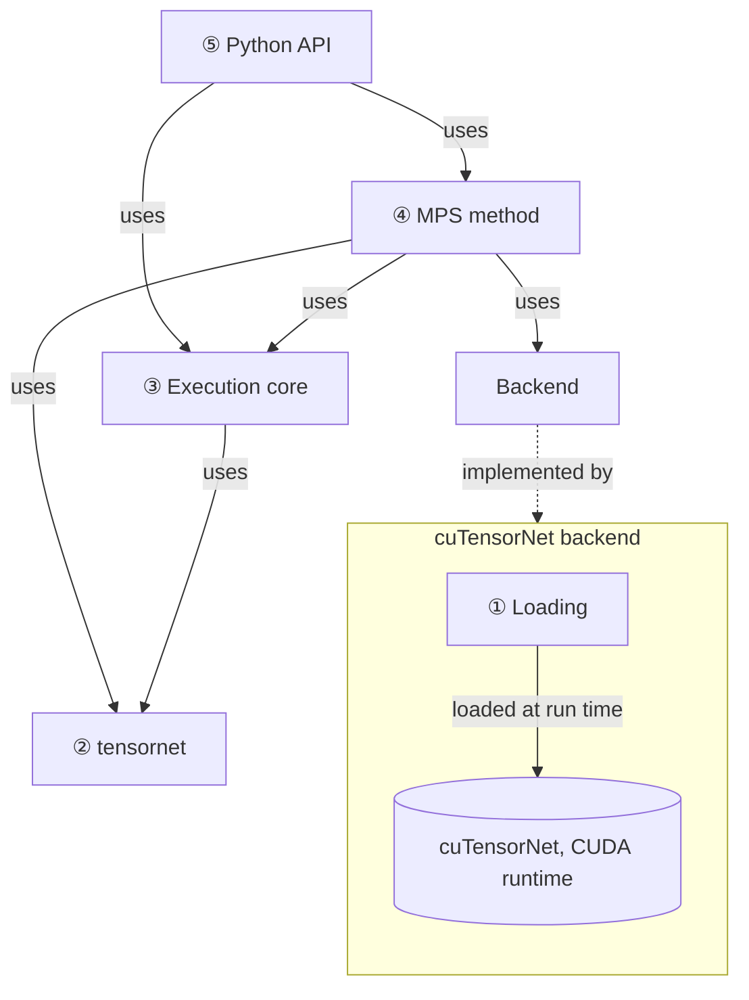
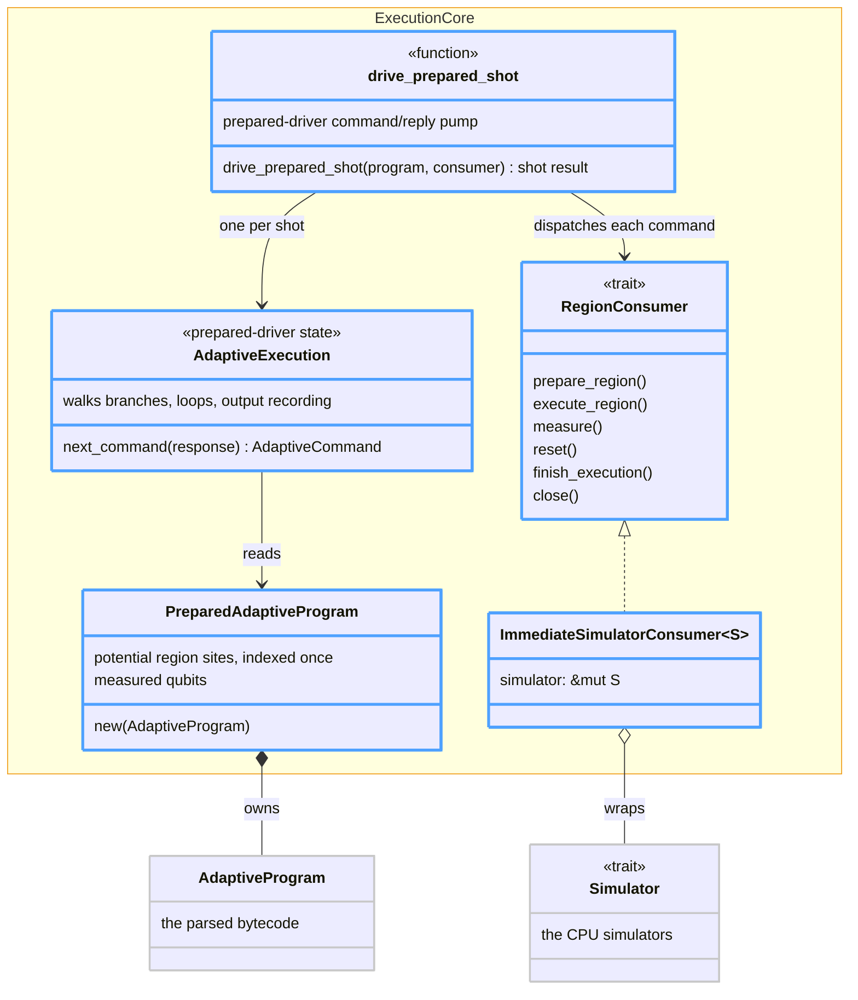
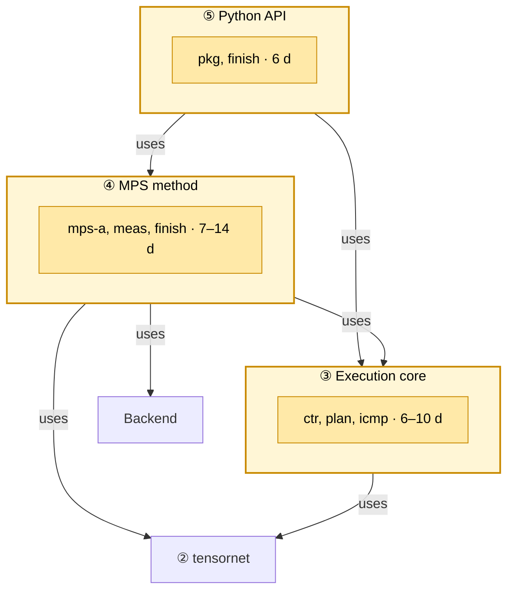
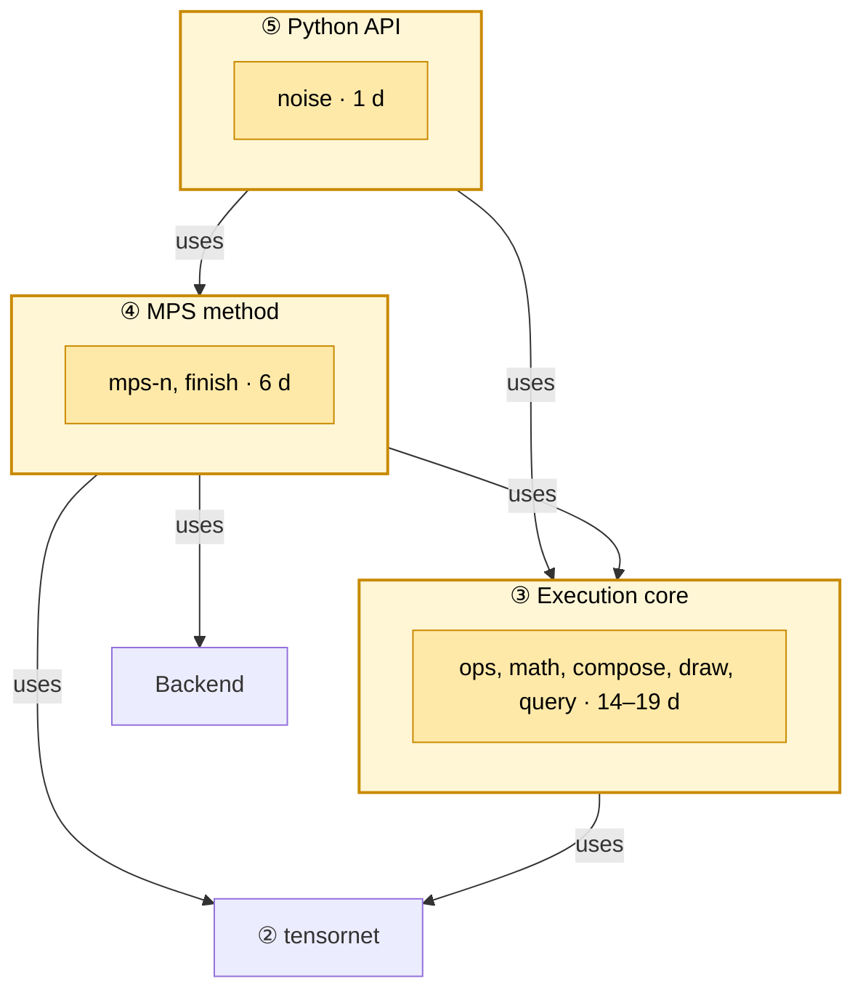
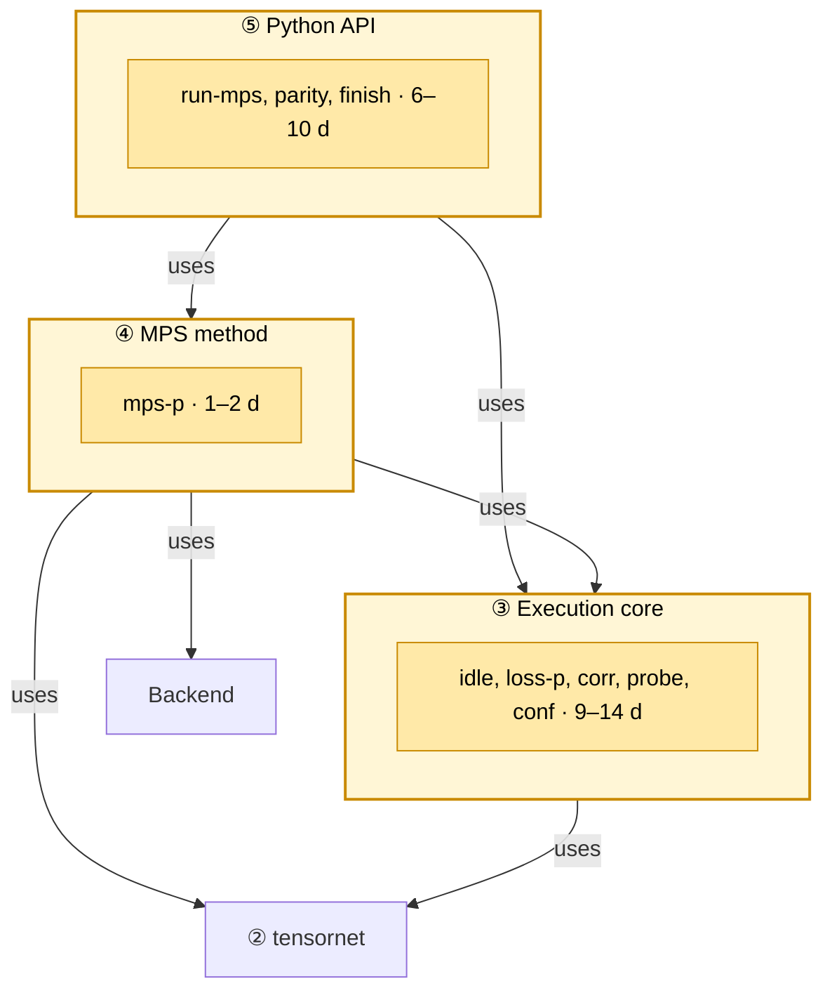
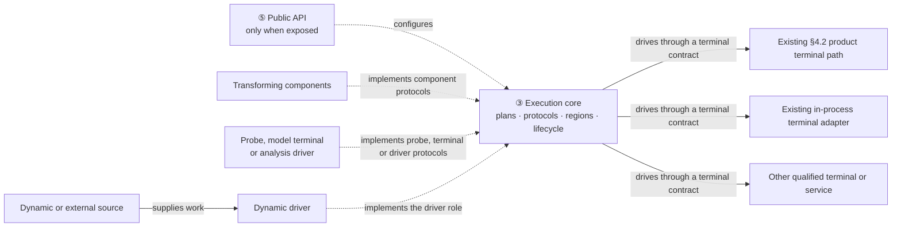
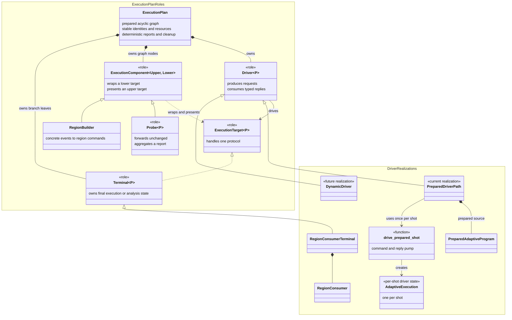
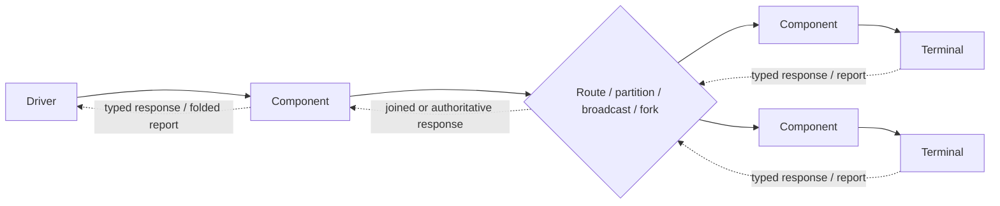
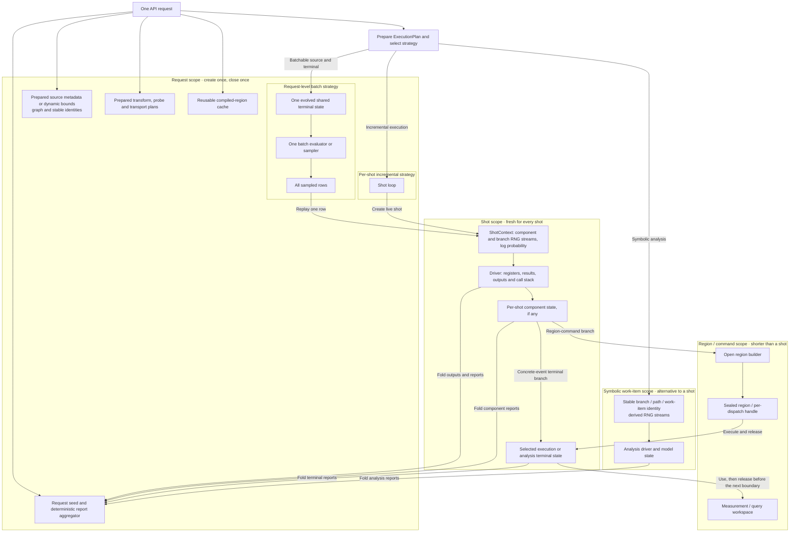

# Tensor-network simulation in the QDK: design

This document proposes how the QDK adds tensor-network simulation, starting
with matrix product states (MPS) on NVIDIA GPUs. It asks QDK developers to
approve the high-level design ([§4](#4-high-level-design)) and the milestone
approach ([§3](#3-approach), [§5](#5-milestone-design)) before the first PRs.
[§1](#1-the-problem)–[§6](#6-what-we-know-and-what-we-dont) make the proposal;
the appendices give the evidence and
can be read later.

## 1. The problem

Chemistry users want to run quantum phase estimation (QPE) circuits from
`qdk-chemistry`, starting with H₂ and scaling to larger molecules. These
circuits contain non-Clifford rotations, each of which must eventually run as
a fault-tolerant gadget.

QEC users simulate those gadgets under noise, starting with the Fire & Ice Rz1
gadget, and report their logical performance. That lets chemistry users know
what to expect when the rotations—and therefore their larger circuits—run
fault-tolerantly.

Supporting that workflow requires two connected simulations: the chemistry
circuits and the gadgets that implement their rotations. Depending on the
program, users need sampled shot results or expectation values. Because MPS
simulation can truncate the state, they also need its cost—the bond dimension
reached, discarded weight and memory required—so that no approximation is
hidden.

The QDK's current simulation methods cannot cover both sides of this workflow.
The sparse simulator runs H₂, but none of the current simulators can run the
Rz1 gadget, and larger chemistry circuits are expected to exceed their limits
too ([Appendix A](#appendix-a-alternatives-to-tensor-networks)). Qodec, now on
`main`, provides an execution framework but no
new simulation method: it drives the same dense, branching-stabilizer and
Clifford engines, and therefore shares their limits.

## 2. Why tensor networks

The QDK's simulators, and the other options, have costs that grow with what the
gadget has plenty of. Dense grows with qubits: the gadget uses 56 at once, so a
dense state needs $2^{60}$ bytes. Sparse grows with non-zero amplitudes,
exponentially many in code states, and stabilizer-based methods with
non-Clifford rotations, several in some constructions.
[Appendix A](#appendix-a-alternatives-to-tensor-networks) compares them. In the
QEC user's words, "the TN approach is essential when we use
constructions with several 1Q rotations".

A tensor network's cost grows with entanglement instead. A matrix product state
(MPS) needs $32\thinspace n\thinspace\chi^2$ bytes for $n$ qubits, rather than the dense
$16\cdot2^n$, where the bond dimension $\chi$ grows with the entanglement
([Appendix B](#appendix-b-matrix-product-states)).

An MPS is exact while its bonds can grow to the dimension required by the
state. In practice, the method caps $\chi$ to bound memory and time. When an
update would exceed that cap or a truncation cutoff, an SVD keeps the largest
singular values and discards the rest. Raising $\chi$ trades resources for
fidelity; `Cost` reports the bond reached and the discarded weight, so the
approximation is controlled and never silent.

That fits the users' needs ([§1](#1-the-problem)):

- **Size.** For the gadget, a bound gives $\chi\le4{,}096$: 28 GiB, within one
  80 GiB GPU.
- **Controlled approximation.** The $\chi$ cap and truncation cutoffs bound
  resource use. If no weight is discarded, the MPS remains exact; otherwise
  `Cost` reports the truncation.
- **Shots.** It draws each mid-circuit measurement from the state, as hardware
  does.

An A100 prototype provides initial evidence that this resource–fidelity
trade-off can help these workflows ([§6.1](#61-what-we-measured)):

- **Low-entanglement circuits can scale far.** A 1,024-qubit quench ran in 34
  seconds at $\chi=12$, beyond the reach of every current QDK simulator.
- **Cost follows entanglement, not qubit count alone.** On 128 qubits, sampling
  took 13 seconds at $\chi=46$ and 26 minutes at $\chi=2{,}048$. The milestones
  therefore measure the $\chi$ reached rather than promising performance from
  qubit count.
- **QEC accuracy can require a substantial $\chi$.** On 78-qubit Fire & Ice
  error-correction rounds, whose Clifford result is independently checkable,
  one record's probability became exact at $\chi=512$; at $\chi=256$ it was
  about 80 times too small. This shows both that MPS reaches relevant code
  sizes and why truncation must be reported.

These results establish feasibility, not the performance of the production
workflows. M1 measures H₂, and M2 measures the full gadget.

We build it into the QDK on NVIDIA's cuTensorNet, a library loaded at run time,
so users keep their programs and tools.

## 3. Approach

We work backwards from the users. Each milestone starts from a program a
user gave us and the check that tells them it works, and builds only what
that program needs:

- **Build on what shows value.** An NVIDIA A100 prototype provides the
  feasibility evidence in [§2](#2-why-tensor-networks) and
  [§6.1](#61-what-we-measured) and was reviewed with both user groups.
  It is ported to `domingom/tensor-network-simulation` one block per commit
  ([§4](#4-high-level-design)); each commit can become a PR.
- **About a month each.** Larger work is split, so value never waits.
- **Production quality.** Each milestone ships tested, documented and
  installable.
- **Evidence revises the plan.** Measurements and feedback from each milestone
  reshape the later ones.

| Milestone | Delivers                                                                                                                                                                                         | For            | Checked by                                                               | Effort estimation                       |
| --------- | ------------------------------------------------------------------------------------------------------------------------------------------------------------------------------------------------ | -------------- | ------------------------------------------------------------------------ | --------------------------------------- |
| M1        | H₂ QPE sampled on MPS without noise, installed with `pip install qdk[tensornetwork]`                                                                                                             | chemistry user | the shot results peak where the chemistry user expects                   | 19–30 d; parallelizable down to 9–17 d  |
| M2        | the Rz1 logical Bell test on MPS with Pauli noise and loss, scored from its logical parities, without a decoder steering the shot                                                                | QEC user       | noiseless logical agreement and smaller-program statistical noise parity | 21–26 d; parallelizable down to 11–14 d |
| M3        | parity with the QDK's simulators and public `run_qir(type="mps")`; Qodec or other execution/analysis consumers may integrate in parallel ([Appendix E.3](#e3-collaboration-and-staged-adoption)) | all QDK users  | MPS parity; integration-specific conformance when a parallel track lands | 16–26 d; parallelizable down to 7–11 d  |

Qodec and other execution or analysis consumers can integrate as a parallel
part of M3 without becoming a dependency of its tensor-network acceptance test
or estimate. [Appendix E](#appendix-e-consumer-mappings-and-staged-adoption)
names the concrete consumers and covers their
collaboration, qualification, execution evolution and migration options.

## 4. High-level design

This section gives the design that holds for every milestone: the
requirements, and the functional blocks the milestones extend.
[§5](#5-milestone-design) starts from
what the branch has today and shows what each milestone changes.

### 4.1 Requirements

- **Simulation semantics.** A simulation terminal running a Base or Adaptive
  QIR program gives the same distribution of shot results as `run_qir`, though
  not the same shot results for a given seed.
- **Weak simulation.** For a simulation terminal, as on hardware, each
  mid-circuit outcome $r_k$ is drawn and fed forward:
  $P(r)=\prod_{k=1}^{M}P(r_k\mid r_{<k})$.
- **Several results per call:** shot results, expectation values and cost.
- **Trustworthy.** Nothing degrades silently: an approximation reports the bond
  dimension it reached and the weight it discarded, anything a method cannot do
  raises a typed error, and a seed with the same source input and configuration
  reproduces every framework-owned stochastic choice.
- **Analysis honesty.** A probe or analysis terminal states its placement,
  path policy, assumptions and result meaning; a synthetic or explored path is
  never presented as a shot produced by a simulator or device.
- **Compatibility.** M1–M3 leave existing `run_qir` behavior and simulators
  unchanged, no build gains a GPU dependency, and vendor code stays in its
  backend's crate. Any M4 migration preserves the public API and distributions
  and ships only after parity and performance gates.
- **Extensible.** Intuitively, a
  [driver](#44-evolution-toward-execution-plans) keeps execution or analysis
  moving: it takes the next work from its source, sends it through the selected
  path, uses the reply to decide what comes next and stops when the work is
  complete. More formally, it is the plan-entry role that turns prepared,
  dynamic or analysis-source work into typed requests and consumes their
  replies. A driver, transforming component, probe, method or terminal plugs
  in through one typed protocol boundary; running a program (branches, loops,
  shots and noise) is written once for all of them.
- **Composable and transport-neutral.** Direct in-process execution is the
  default; routing, splitting, Qodec, QRE and an optional channel, process or
  network transport compose without changing the protocol's semantics.
- **Testable.** Each part is tested through its contract against an independent
  oracle, mostly without a GPU ([Appendix F](#appendix-f-testing-in-ci)).

The committed tensor-network implementation scope ends at M3 and at the
cuTensorNet backend, and therefore NVIDIA GPUs
([§4.2](#42-functional-blocks)). Collaborator-owned
Qodec/QRE paths may also qualify at M3 without entering that estimate or
acceptance dependency. M4 promotion or simulator migration and M5 dynamic
execution remain separate decision gates (Appendices D–E).

### 4.2 Functional blocks

Five blocks, numbered from the lowest level to the highest. ④ is the first
method, and the box around ① the first backend, which implements the Backend ④
uses; others can be added beside them. A milestone changes what is inside the
blocks, not their dependencies ([§5](#5-milestone-design)).



**① Loading** finds and loads cuTensorNet and the CUDA runtime at run time, so
no build depends on CUDA and users who don't need them are unaffected. Only
versions with an audited ABI load
([Appendix C](#appendix-c-cutensornet-versions-and-installation)); a failure is a [typed
availability error](cutensornet/src/error.rs), raised by the query that needed the library.

**The cuTensorNet backend** is ① and the library it loads. A backend runs a
method's numerics on one library and device: memory, tensors, gate application
and truncation, and measurement marginals. cuTensorNet comes first: the gadget
needs a GPU ([§2](#2-why-tensor-networks)), and cuTensorNet applies gates to an
MPS with truncation,
samples it, and optimizes contraction paths for later methods; CUDA-Q's
tensor-network backends use it too. Another backend, such as tensor4all-rs for
an MPS on the CPU, can be added beside it without changing the methods. Until
then, ④ calls cuTensorNet directly; the backend interface is extracted when the
second backend arrives, shaped by both.

**② tensornet** describes tensor networks by their shape, today
[the MPS](tensornet/src/mps.rs), but not how they are built or contracted, so
the same description goes to a GPU library, a CPU library or a test's
reference implementation.

**③ Execution core** owns the execution shared by tensor-network methods and
existing QDK simulators. It prepares the program, walks branches, loops and
shots, and keeps what execution paths share: shot results, the shot context,
stable component-derived random streams and noise orchestration. For the
M1–M3 tensor-network path, ③ sends immutable regions, measurements and resets
through its `RegionConsumer` contract; the terminal owns execution state and
never selects a program branch. ③'s contracts
([consumer](simulators/src/execution/region.rs), queries, [observables](simulators/src/execution/pauli_sum.rs)) are neutral to simulators and
backends, and ③ depends on none of them.
[§4.3](#43-execution-core)–[§4.4](#44-evolution-toward-execution-plans)
describe the concrete prepared path and its evolution;
[Appendix D](#appendix-d-execution-plan-architecture-m1) generalizes the same contracts to
typed execution targets, components, probes, drivers and other terminal
protocols.

**④ MPS method** represents the state as a chain of site tensors whose bonds it
truncates. It [implements ③'s consumer contract](cutensornet/src/library/simulation/consumer.rs#L227) and [queries](cutensornet/src/execution.rs), describes its state
with ②'s [`Mps`](tensornet/src/mps.rs#L41), takes gate matrices from ③'s [shared tables](simulators/src/execution/operator_matrix.rs), and runs its
numerics on [a backend](cutensornet/src/library/simulation.rs). Other methods
([§3](#3-approach)) can be added beside it without
changing ③ or ⑤.

The current implementation of ④ remains in `cutensornet` even where its Rust
mechanics compile and are tested on every host. Those mechanics model
cuTensorNet's state, workspace, sampler and cleanup lifecycle behind test
seams. _Host-portable_ says where the code can compile and be tested; it does
not make the implementation _backend-neutral_ or part of ②. Only the
mathematical MPS description is shared through ②, and the backend interface is
extracted when a second backend arrives.

`Sample` uses two strategies. For a Base program, the batch strategy evolves
one MPS and samples every shot from it. For an Adaptive program, the
incremental strategy evolves one MPS per shot: ③ drives it region by region,
and the consumer draws each measurement from the state and returns it to ③ for
feedforward ([§4.3](#43-execution-core)). `Expectation` reads the state before
terminal measurements;
`Cost` reports the resources used by the call.

**⑤ Python API** is [`tensornetwork_qir`](qdk_package/qdk/simulation/_tensor_network.py): a Base or Adaptive QIR program and a
list of queries in, one value per query out. It is a new function because
`run_qir` returns only shot results and takes no method options, and could not
gain either without changing its callers; M3 adds `run_qir(type="mps")` on top
of it ([§5.4](#54-m3-parity-with-the-qdks-simulators)). `method` selects the
method and `options.backend` the backend,
and with it the device; `seed` and `noise` are keywords, as on `run_qir`. ⑤
reaches methods and backends only by name, through ③'s contracts. For example,
H₂'s shot results and cost ([§5.2](#52-m1-h₂-qpe-on-mps)):

```python
from qdk.simulation import Cost, MpsOptions, Sample, tensornetwork_qir

shots, cost = tensornetwork_qir(
    qir,
    [Sample(1000), Cost()],
    method="mps",
    options=MpsOptions(max_bond_dimension=256),
    seed=42,
)
```

Each query returns one value:

| Query                | Returns                                                                                              | Notes                                                                                                                                       |
| -------------------- | ---------------------------------------------------------------------------------------------------- | ------------------------------------------------------------------------------------------------------------------------------------------- |
| `Sample(shots)`      | shot results, as `run_qir` returns them                                                              | Base and Adaptive; `seed` reproduces them; the only query that accepts `noise` (M2)                                                         |
| `Expectation(terms)` | $\langle\psi\vert O\vert\psi\rangle$, $O=\sum_k c_k P_k$, from `(paulis, qubits, coefficient)` terms | $\psi$ is the state before the terminal measurements; a mid-circuit measurement is an unsupported-operation error, as in CUDA-Q's `observe` |
| `Cost()`             | a dict: the largest bond reached, the discarded weight, state and workspace bytes                    | over the call's other queries                                                                                                               |

Errors subclass today's exceptions, so existing handlers keep working: device
unavailable and resource limit exceeded are `OSError`s; unsupported operation
and invalid input are `ValueError`s.

### 4.3 Execution core

On `main`, three interpreters run programs: the CPU runtime, the GPU
simulator's WGSL shader and Qodec's Python interpreter. Each has its own walk,
shot loop and opcode table, and hands its simulator one operation at a time. A
tensor-network method added to any of them, Qodec included, could not receive
regions (below) or answer queries such as `Expectation`; in Qodec, each
operation would also be a Python call holding the GIL. ③ writes the common part
once, in Rust, and Qodec can reuse it through owner-defined execution
components without moving its domain logic into ③
([Appendix E](#appendix-e-consumer-mappings-and-staged-adoption)).

**Regions.** ③ prepares a program once, before any shot, and indexes each basic
block's potential
[_region sites_](simulators/src/execution/region.rs#L25): maximal runs of
consecutive gates, closed by any other instruction.

```text
 block 7:  cz cz h │ ADD │ cz s sx │ MEASURE │ READ_RESULT │ BRANCH
           └region┘        └region─┘
```

A _shot_ is one execution of the prepared program from its initial state,
producing one output record. During a shot, the walk follows the program's
branches and loops. When it reaches a site, it evaluates the gates'
arguments—such as rotation angles and qubit IDs—using the current
classical-register values. The runtime region builder may send the whole run
as one immutable region command or seal it earlier under `RegionPolicy`; it
never joins operations across a prepared boundary. Region sites let a
simulator:

- see many gates at once, to fuse them or to pay one GPU dispatch for them;
- recognize a site met again, in a loop or in another shot; a cache can combine
  that stable identity with the concrete operations and policy split.

More generally, the current prepared driver has two parts.
`AdaptiveExecution` is its per-shot state machine: it emits commands to execute
a region, measure, reset or complete from the previous response.
`drive_prepared_shot` is its command/reply pump: it dispatches each command
through the [`RegionConsumer`](simulators/src/execution/region.rs#L45) terminal
contract and returns the consumer's response to `AdaptiveExecution`. A
consumer may evolve a target incrementally, or replay results produced by
request-level batch execution so that shared control can reconstruct each
shot's outputs.
[`ImmediateSimulatorConsumer`](simulators/src/execution/immediate.rs#L106) is
the incremental compatibility adapter for an existing `Simulator`; it executes
every operation in a region one at a time. Base MPS sampling uses the batch
strategy: request-level orchestration evolves one state and samples every shot,
then a consumer replays each sampled row through the driver.

Adaptive MPS sampling (M1's `mps-a`, [§5.2](#52-m1-h₂-qpe-on-mps)) uses the
incremental strategy:
shots run one at a time, and the consumer holds one live MPS for the shot,
applies each reached region, draws each measurement from the MPS, projects it
onto the outcome and returns that outcome to ③ for feedforward.

From ③'s perspective, execution has two stages. The caller first wraps the existing
[`AdaptiveProgram`](simulators/src/bytecode.rs#L22) in a new execution-core
type, `PreparedAdaptiveProgram`, by invoking
[`PreparedAdaptiveProgram::new`](simulators/src/execution/adaptive.rs#L228)
once. This retains the bytecode and indexes its potential region sites. The
caller then calls
[`drive_prepared_shot`](simulators/src/execution/immediate.rs#L170) once per
shot, passing the prepared program and that shot's consumer. Each call creates
fresh [`AdaptiveExecution`](simulators/src/execution/adaptive.rs#L346) state,
dispatches commands until the shot completes or fails, closes the consumer on
every path, and returns the shot's output and consumer reports. The caller owns
the shot loop and any request-level resources, such as a batch sampler or
device session.

In M1–M3, `AdaptiveProgram` is a trusted internal representation produced by
QIR lowering, not an untrusted public input format. Preparation validates the
region and consumer-facing metadata it derives; the walk assumes structural
references such as block targets and register and result indices are valid.
Each opcode task preserves this boundary and adds parity and typed-error tests
for the behavior it introduces. Validating arbitrary manually constructed
bytecode is not part of these milestones.

**Classes.** These classes implement ③'s M1–M3 prepared region-command path.
The execution-core classes are in blue, and the classes on `main` they build
on are in grey.
[Appendix D.2](#d2-typed-protocols-and-execution-components) shows how
execution-plan composition wraps this path rather than replacing it:



Three invariants hold:

- [`PreparedAdaptiveProgram`](simulators/src/execution/adaptive.rs#L217) is
  read-only, so shots share nothing mutable.
- `reset` is mandatory, so a simulator that cannot reset returns an error.
- [`drive_prepared_shot`](simulators/src/execution/immediate.rs#L170) calls
  `close` on the consumer on every return path. A consumer releases the
  resources it owns there; the caller releases request-level resources.

[`execution::tooling::ConditionedCircuit`](simulators/src/execution/tooling/conditioned_circuit.rs#L46)
is qualification tooling, not a production execution path. It uses the same
driver with fixed measurement outcomes to turn one selected path into
unitaries and rank-one projections; evaluating that circuit gives a reference
probability for checking a method's sampling and projection behavior (Appendix
F).

### 4.4 Evolution toward execution plans

M1–M3 use the prepared path above: the whole bytecode program is known,
`PreparedAdaptiveProgram` indexes potential region sites once, and each shot
resolves only the path it reaches. Static preparation does not mean static
control flow. Functions whose bodies are in the bytecode, including functions
with measurements and branches, remain on this path once `CALL` and
`CALL_RETURN` are added in M2.

The **driver** is the plan-entry role. It turns a prepared, dynamic or analysis
source into typed requests, consumes their replies and decides the next work
or completion. It owns source-control state, not the final simulation or
analysis state. An **execution plan** prepares an owned acyclic graph of typed
execution components for that driver. Transforming components may translate,
split, route or observe requests; a core-owned region builder forms immutable
regions for targets that use them; and each reached branch ends in a terminal
that owns its final execution or analysis state. A simulation
`RegionConsumer` owns quantum state, while an approximate QRE terminal owns a
resource model instead. Requests flow toward terminals and replies flow back,
so a component may issue more work after a measurement without changing the
graph. A dynamic instruction source is one possible driver, not a requirement
for runtime expansion inside Qodec or another component.

The classes in [§4.3](#43-execution-core) are one concrete realization of
these roles: `PreparedAdaptiveProgram` is the prepared source,
`AdaptiveExecution` is its per-shot driver state and `drive_prepared_shot` is
the command/reply pump. Together they implement the prepared-driver path,
while `RegionConsumer` is one protocol-specific terminal contract. Plans
compose that path with transforming components, probes, routing or alternative
terminals.

M1 establishes the bottom protocols, deterministic component context, lifecycle
and extensible region-sealing rules. M2 uses the sequential component contract
for noise and typed queries. M3 adds transparent probes and conformance tests,
so Qodec and QRE adapters developed in parallel can qualify and integrate by
M3 exit. M4 promotes only a composition deferred from M3 and may migrate
existing simulators; M5 may add genuinely dynamic sources. Throughout, ③ owns
semantic ordering and mandatory boundaries. A policy may seal earlier, and a
region-command terminal may split internally, but neither can merge work
across a core boundary.
[Appendix D](#appendix-d-execution-plan-architecture-m1) defines the full
composition, interaction and ownership model, including the class/role mapping
in [D.2](#d2-typed-protocols-and-execution-components).
[Appendix E](#appendix-e-consumer-mappings-and-staged-adoption) maps Qodec, QRE
and other simulators onto those roles and describes staged collaboration and
qualification.

## 5. Milestone design

Each milestone is drawn on [§4.2](#42-functional-blocks)'s blocks, with the
blocks it changes highlighted, and their tasks and effort.
[§5.1](#51-today-the-starting-point) is the starting point. M1–M3
efforts are for one implementer and include tests, not review; a task needs
only the tasks it lists and the preceding committed milestones. M4 and M5 are
decision-gated tracks whose prerequisites and exit criteria are explicit
rather than depending on every optional migration.

### 5.1 Today: the starting point

The table lists what each block has in the branch once the prototype is
ported ([§3](#3-approach)).

| Block            | In the branch                                                                                                                                                                                                                                                                                                                                                                                                                                                                                                                                                                                                                    |
| ---------------- | -------------------------------------------------------------------------------------------------------------------------------------------------------------------------------------------------------------------------------------------------------------------------------------------------------------------------------------------------------------------------------------------------------------------------------------------------------------------------------------------------------------------------------------------------------------------------------------------------------------------------------- |
| ① Loading        | [`source/cutensornet`](cutensornet/README.md) ([`bindings`](cutensornet/src/bindings/mod.rs), [`library`](cutensornet/src/library.rs)): cuTensorNet 2.13 and CUDA runtime 12.9, audited, on Linux x86_64                                                                                                                                                                                                                                                                                                                                                                                                                         |
| ② tensornet      | [`source/tensornet`](tensornet/README.md): `Mps`, the shape of a matrix product state                                                                                                                                                                                                                                                                                                                                                                                                                                                                                                                                            |
| ③ Execution core | [`source/simulators/src/execution`](simulators/src/execution/README.md): preparation and regions, the walk, [`RegionConsumer`](simulators/src/execution/region.rs), [`ImmediateSimulatorConsumer`](simulators/src/execution/immediate.rs), [`PauliSum`](simulators/src/execution/pauli_sum.rs), [the shared gate tables](simulators/src/execution/operator_matrix.rs)                                                                                                                                                                                                                                                            |
| ④ MPS method     | [`source/cutensornet`](cutensornet/README.md#the-mps-method) ([`execution`](cutensornet/src/execution.rs), [`library::simulation`](cutensornet/src/library/simulation.rs)): `Sample` of Base programs with the batch strategy ([§4.3](#43-execution-core)): one MPS, every shot sampled from it, each sampled row replayed through ③; ③ reconstructs outputs but does not drive cuTensorNet yet; `Expectation`; the `Cost` of `Expectation`; [tested against test doubles](cutensornet/src/library/simulation/mps_execution/tests.rs), [qualified on an A100](cutensornet/src/library/simulation/mps_execution/qualification.rs) |
| ⑤ Python API     | [`source/qdk_package`](qdk_package/README.md): [`tensornetwork_qir`](qdk_package/qdk/simulation/_tensor_network.py) with `Sample`, `Expectation`, `Cost`; `MpsOptions(backend, max_bond_dimension)`; `seed`. Not yet: `Sample` of Adaptive programs, `Cost` with `Sample`; their errors say they come in the next release                                                                                                                                                                                                                                                                                                        |

### 5.2 M1: H₂ QPE on MPS

The chemistry user installs `qdk[tensornetwork]` and samples his H₂ QPE with
`tensornetwork_qir(qir, [Sample(shots)], method="mps")`. His acceptance test:
the shot results, qubits 0–4 read most significant first, peak at `01010` and
`10110`. These are the ±θ eigenphase pair (10 + 22 = 32), which also fixes the
bit order. The test needs no reference; the sparse simulator, which runs H₂,
adds a parity check.

H₂ has 29 qubits, 1,404 measurements and 399,537 instructions. Beyond what ③
supports today, it needs only `ICMP`, for 713 branch conditions on the XOR of
two or three results. Its 1,400 regions have a median of 7 gates and at most
351, so a shot's cost follows its measurements, not its gates. M1 measures
shared-control time separately from MPS measurement time. If scanning the
1,400 regions is material, preparation indexes region starts; negligible
overhead needs no optimization.



| Block | Task     | Needs                 | Effort     | Delivers                                                                                                                                                                                                                                                                                                         |
| ----- | -------- | --------------------- | ---------- | ---------------------------------------------------------------------------------------------------------------------------------------------------------------------------------------------------------------------------------------------------------------------------------------------------------------- |
| ③     | `ctr`    | —                     | 2–3 d      | `ShotContext { request_seed, shot_index, log_p }`; deterministic streams derived by stable component identity; `measure` returns the outcome and its probability; exact replay, shot-order and parallelism tests                                                                                                 |
| ③     | `plan`   | —                     | 3–5 d      | the prepared-source execution plan's typed concrete-event and region-command protocols; a terminal `RegionConsumer` adapter; mandatory boundary classification; additive earlier-only `RegionPolicy`; request, shot and command ownership; finish, partial-start, reverse-close and all-error preservation tests |
| ③     | `icmp`   | —                     | 1–2 d      | the `ICMP` opcode, ported from the CPU runtime, with parity and typed-error tests                                                                                                                                                                                                                                |
| ④     | `meas`   | `icmp`                | 1–2 d      | on the A100, the time per MPS measurement, shared-control time and the $\chi$ reached on H₂                                                                                                                                                                                                                      |
| ④     | `mps-a`  | `ctr`, `plan`, `icmp` | 1–2 wk     | adaptive `Sample` with the incremental strategy ([§4.3](#43-execution-core)): one MPS terminal per shot; measurements drawn from it and fed back through the plan; resets                                                                                                                                        |
| ④     | `finish` | `mps-a`               | 1–2 d      | typed errors; bond reached and discarded weight in `Cost`, for `Sample` and `Expectation`                                                                                                                                                                                                                        |
| ⑤     | `pkg`    | —                     | about 1 wk | the install and preflight contract in [Appendix C](#appendix-c-cutensornet-versions-and-installation): `qdk[tensornetwork]`, library discovery, actionable diagnostics and release-GPU validation                                                                                                                |
| ⑤     | `finish` | —                     | 1 d        | typed Python errors; GIL released during GPU work                                                                                                                                                                                                                                                                |

`pkg` owns the path from a clean Python environment to the first GPU call. It
pins NVIDIA's audited wheels, finds their shared libraries without requiring
the user to edit `LD_LIBRARY_PATH`, retains the system-install and explicit
override paths, and provides a preflight that distinguishes an unsupported
host, driver, GPU, missing library, transitive dependency and version mismatch.
Its clean-environment tests install only the published extra; the release GPU
then runs that preflight, a small MPS call and the Rust qualification
(Appendices C and E).

`mps-a` keeps one owner for the live MPS. Each measurement's shorter-lived
expectation, workspace and temporary allocations are released before the next
measurement. It uses the terminal adapter from `plan`; M1 does not yet need a
runtime-configurable graph, Qodec ISA protocols or a dynamic driver.

The critical path is `plan` → `mps-a` → `finish` (④), 9–17 days. `ctr` and
`icmp` run in parallel before `mps-a`; `meas` runs in week one, and its numbers
are not acceptance conditions.

### 5.3 M2: the Rz1 logical Bell test with noise on MPS

The QEC user samples the Rz1 logical Bell test, a [[20,2,6]] code on 56 live
qubits, with `tensornetwork_qir(qir, [Sample(shots)], method="mps",
noise=...)`, and scores the shot results offline; no decoder steers the shot.
M2 has two acceptance tests:

- Without noise, the two logical outcomes match on every shot, at non-Clifford
  angles. The test therefore needs no reference, and the QDK has none at this
  size.
- With noise, the shot results agree statistically with the CPU full-state
  simulator's under the same `NoiseConfig`, on smaller programs it can run.

Rz1 repeats a teleported rotation, doubling the angle, until the rotation
lands; each round's angle needs `cos`, `sin` and `arccos` of measured values.
Until those exist, a bounded form runs: at most 6 rounds, with angles fixed at
compile time. A shot that did not finish, with probability $2^{-6}$ per logical
qubit, is flagged. The bounded test lowers to about 28,600 instructions.



| Block | Task      | Needs     | Effort     | Delivers                                                                                                                                                                                                                                       |
| ----- | --------- | --------- | ---------- | ---------------------------------------------------------------------------------------------------------------------------------------------------------------------------------------------------------------------------------------------- |
| ③     | `ops`     | —         | about 1 wk | 10 opcodes ported from the CPU runtime, each with parity and typed-error tests: `ADD`, `ALLOCA`, `CALL`, `CALL_RETURN`, `GEP`, `LOAD`, `MOV`, `SELECT`, `STORE`, `XOR`                                                                         |
| ③     | `math`    | —         | 2–3 d      | for the unbounded gadget, if needed: `cos`, `sin` and `arccos` in the lowering, bytecode and walk, with parity and typed-error tests; new, since the CPU runtime lacks them                                                                    |
| ③     | `compose` | —         | 3–5 d      | sequential `ExecutionComponent<Upper, Lower>` composition; request/reply and report propagation; requirements derived from the program and transformed through components; terminal capability validation; typed component context on failures |
| ③     | `draw`    | `compose` | 2–3 d      | noise as the first transforming component: Pauli faults, loss and readout changes drawn from stable noise streams and represented independently of a terminal; the default `LossPolicy` skips gates on lost qubits                             |
| ③     | `query`   | —         | 2–3 d      | typed query requests and responses move from ④ to ③ as mandatory boundaries; ④ answers them, ⑤ calls ③, and `tensornetwork_qir` is unchanged                                                                                                   |
| ④     | `mps-n`   | `draw`    | about 1 wk | the concrete faults and loss produced by the noise component applied by the MPS terminal                                                                                                                                                       |
| ④     | `finish`  | `mps-n`   | about 1 d  | typed errors and reports for the noise paths                                                                                                                                                                                                   |
| ⑤     | `noise`   | `draw`    | about 1 d  | `noise: Optional[NoiseConfig] = None`, checked as on `run_qir`; noise with a query other than `Sample` is a typed error                                                                                                                        |

The critical path is `compose` → `draw` → `mps-n` → `finish` (④), 11–14
days. M2 reports the $\chi$ reached on the gadget. The component contract is
terminal-neutral: MPS is its first GPU use, not part of its type.

### 5.4 M3: parity with the QDK's simulators

Every `run_qir` user can choose MPS: `run_qir(qir, shots, noise, seed,
type="mps")` runs `tensornetwork_qir`'s `Sample` and returns the same results
as the other types. `type=None` still selects the GPU, then the CPU. The
acceptance test is the parity suite: on shared programs and noise models, MPS's
shot results agree statistically with every other `run_qir` type that runs the
program.

M3 completes `NoiseConfig` on MPS. As in M2, a core component draws the noise
and the terminal applies its concrete effects. `qodec` and `decoder` remain
typed errors with `type="mps"` in the committed MPS acceptance scope. A
parallel integration may remove that restriction before M3 exits if the Qodec
adapter and selected QRE roles pass the composition gates below and their
owners approve the entry points. Runtime expansion inside the Qodec component
does not require the
[dynamic driver](#d1-execution-plans-and-drivers).
`run_qir` takes no method options, so `type="mps"` uses the `MpsOptions`
defaults, $\chi\le128$, and warns when truncation discards weight. To set
$\chi$ or read the truncation costs, call `tensornetwork_qir`. Efforts are
estimated from the CPU simulator's code, not the prototype's, and are
revisited when M2 ends.



| Block | Task      | Needs                      | Effort | Delivers                                                                                                                                                                                                                            |
| ----- | --------- | -------------------------- | ------ | ----------------------------------------------------------------------------------------------------------------------------------------------------------------------------------------------------------------------------------- |
| ③     | `idle`    | —                          | 1–2 d  | idle noise (`IdleNoiseParams`), from each qubit's time since its last operation, as on the CPU                                                                                                                                      |
| ③     | `loss-p`  | —                          | 2–3 d  | the four other `LossPolicy` variants: propagate, degrade, residual S†, apply anyway                                                                                                                                                 |
| ③     | `corr`    | —                          | 2–3 d  | correlated-noise intrinsics, drawn as multi-qubit Pauli faults                                                                                                                                                                      |
| ③     | `probe`   | —                          | 2–3 d  | a transparent `Probe<P>` identity component installable at named protocol boundaries; requests and replies pass unchanged, no random values are consumed, and tracing, timing or realized-work reports fold into the request report |
| ③     | `conf`    | `probe`                    | 2–3 d  | reusable protocol, mandatory-boundary, resource, lifecycle, combined-failure, deterministic-stream and probe-transparency conformance tests for components and terminals                                                            |
| ④     | `mps-p`   | `idle`, `loss-p`, `corr`   | 1–2 d  | those faults applied to the MPS                                                                                                                                                                                                     |
| ⑤     | `run-mps` | —                          | 2–3 d  | `"mps"` among `run_qir`'s types, backed by `Sample`, with the same input checks                                                                                                                                                     |
| ⑤     | `parity`  | `run-mps`, `mps-p`, `conf` | 3–5 d  | the statistical parity suite and execution-contract conformance gate, in the release pipeline                                                                                                                                       |
| ⑤     | `finish`  | `run-mps`                  | 1–2 d  | typed errors raised by `run_qir`, and the truncation warning                                                                                                                                                                        |

Two branches feed `parity`: the slower of `loss-p` and `corr` → `mps-p` takes
3–5 days, while `probe` → `conf` takes 4–6 days. With `parity`, the critical
path is therefore 7–11 days. During M2/M3, Qodec owners can build an
ISA-protocol adapter and one-to-many request/reply tests, while QRE owners can
build realized-work probes and an approximate terminal. Those parallel
contributions do not change M3's tensor-network person-day estimate or its
mandatory public acceptance test. They can nevertheless qualify and integrate
at M3 exit; the gates in [§5.5](#55-m4-optional-promotion-and-simulator-migrations)
apply regardless of whether qualification
finishes in M3 or continues in M4.

### 5.5 M4: optional promotion and simulator migrations

M4 is not the first point at which Qodec or QRE can integrate. It contains any
composition track that was not ready or approved at M3 exit, plus independent
simulator-adoption tracks:

- The **composition track** supports the
  [prepared-driver path](#43-execution-core), in which
  protocol-qualified Qodec components lower to concrete events, an explicitly
  placed realized-QRE probe observes actual requests and replies, optional
  noise runs at a named position, and the core region builder reaches a
  selected simulator or device terminal. An approximate-QRE terminal may
  instead end the branch at the qualified logical-ISA, physical-ISA,
  concrete-event or region-command protocol that its hardware model
  understands, using a named deterministic path policy.
- The **simulator-adoption track** may move the CPU full-state or stabilizer
  simulator behind the region-command terminal adapter. Each migration is a
  separate choice. The GPU full-state simulator keeps its device-batched path.

The composition depends on M1's protocols and lifecycle, M2's sequential
composition and capability flow, and M3's probes and conformance suite. A path
that satisfies the following gate by M3 exit can integrate then; M4 finishes
or promotes only deferred work. Neither timing requires a dynamic source,
runtime topology mutation, transport, or a public arbitrary-plan builder.

The composition track exits when:

1. a Qodec instruction that measures, receives a decoder response and emits
   correction work runs through the selected terminal with correlated typed
   replies;
2. a runtime-defined ISA registers without a core enum change, resolves names
   before hot-path execution, rejects a malformed schema or unsupported
   capability before use, and retains the same semantics under a different
   numeric-ID assignment;
3. moving the QRE probe before or after noise produces the documented ideal or
   noisy count without changing execution;
4. an approximate terminal installed at a declared protocol boundary
   reproduces its synthetic path exactly from its policy and seed and reports
   its assumptions and result meaning;
5. rejection, cancellation, terminal failure and partial startup preserve
   component context and every cleanup error; and
6. the supported entry point preserves the existing Qodec API and exposes the
   agreed QRE mode and report without exposing Qodec ISA details through the
   generic execution core.

A CPU-simulator migration exits separately when the existing parity suite
passes and a benchmark shows acceptable per-shot overhead. A transport adapter
may land only if it passes the same protocol suite as the direct handler;
transport is not an integration or M4 acceptance dependency. Any remaining
scope and effort are estimated with the Qodec and QRE owners at M3 exit.

### 5.6 M5: dynamic sources and symbolic analysis

M5 adds two [driver roles](#44-evolution-toward-execution-plans) over the same
prepared, fixed-topology component graph. It depends on the M1–M3 contracts
and the model components selected for its use case, not on either optional M4
simulator migration:

- A **dynamic source** produces work incrementally. It declares a safe resource
  bound or uses checked incremental acquisition before new work consumes a
  resource. Expansion after a reply inside a Qodec component is already a
  prepared-plan behavior available to an M3 integration and does not require
  this driver.
- A **symbolic-QRE driver** creates branch or work items to calculate an
  expected, bounded or worst-case result. It may reuse Qodec lowering and QRE
  model components, but its report cannot claim that an explored path was an
  executed shot.

The dynamic-source path exits when resource rejection occurs before use,
completion and cancellation are typed, and identical seeds and source inputs
produce identical work, replies and reports under different schedules. The
symbolic path exits against small exact analysis oracles and reports its path
policy, assumptions, aggregation and result meaning.

Host callbacks, structural route/partition/broadcast/fork-join components,
remote transports and a public custom-plan builder are compatible follow-on
tracks, not hidden M5 acceptance requirements. If a selected M5 use case needs
one, that feature receives its own conformance and performance gate. Runtime
topology mutation remains out of scope. Other numerical methods can become
terminals without waiting for M5. The Q# sparse-state runtime is a candidate
M5 or follow-on source/terminal pair once its dynamic qubit
allocation/release, queued-operation flushing and state-query semantics have
typed protocol representations.

## 6. What we know and what we don't

### 6.1 What we measured

On the prototype, on an A100:

- **Cost follows $\chi$, not depth.** On 128 qubits, sampling took 13 s at
  $\chi=46$ and 26 min at $\chi=2{,}048$.
- **Low entanglement scales far.** A 1,024-qubit quench, beyond every QDK
  simulator, took 34 s at $\chi=12$.
- **QEC programs can need a large $\chi$.** On the QEC user's Fire & Ice
  error-correction rounds, Clifford and so checkable, one record's probability
  on 78 qubits was exact only from $\chi=512$; at $\chi=256$ it was about 80×
  too small.

### 6.2 Limits we accept

Each is the cost of a choice in this design.

- **Adaptive `Sample` uses the incremental strategy; Base `Sample` uses the
  batch strategy ([§4.3](#43-execution-core)).** Adaptive shots run one at a
  time, as in CUDA-Q's
  tensor-network backends; Base programs draw every shot from one state. This
  is a baseline: since each component's random stream depends only on the
  request seed, shot index and stable component identity
  ([§5.2](#52-m1-h₂-qpe-on-mps)), faster
  strategies, such as walking once the shots that share outcomes, can be added
  to ③ later.
- **Shared execution uses 64-bit bytecode in M1–M3.** Their Python paths lower
  with `Bytecode.Bit64`, while region consumers receive concrete operations and
  are word-agnostic. Generalizing the walk to another word size waits for a
  frontend that needs it.
- **NVIDIA GPUs on Linux x86_64 only,** until a second backend arrives
  ([§4.2](#42-functional-blocks)).
  Elsewhere, a query raises a typed availability error.
- **The GPU path is tested only at release,** not on every PR
  ([Appendix F](#appendix-f-testing-in-ci)). PR
  CI covers it through test doubles.
- **The dependency is proprietary:** cuTensorNet is under NVIDIA's licence. The
  QDK redistributes nothing; users install NVIDIA's wheels
  ([Appendix C](#appendix-c-cutensornet-versions-and-installation)).

### 6.3 What we don't know yet

- **M1** measures the time per MPS measurement on H₂, which has 1,404 per shot
  (`meas`, [§5.2](#52-m1-h₂-qpe-on-mps)).
- **M2** reports the gadget's $\chi$ and its time per shot. If shots are too
  slow for the QEC user's statistics, calls with different seeds can spread
  them over GPUs, and Clifford-augmented MPS becomes the first proposal after
  M3.
- **The team** decides which cuTensorNet versions the extra accepts and the
  minimum driver policy; `pkg` validates both install routes and the preflight
  contract ([Appendix C](#appendix-c-cutensornet-versions-and-installation)).
  The team also checks whether the release pipeline's GPU pool has an NVIDIA
  GPU ([Appendix F](#appendix-f-testing-in-ci)).

## Appendix A. Alternatives to tensor networks

The QDK's simulators, and the other alternatives, each fall short:

| Alternative                                                                     | Cost grows with             | Why it falls short                                                                                    |
| ------------------------------------------------------------------------------- | --------------------------- | ----------------------------------------------------------------------------------------------------- |
| Dense full state, also on larger hardware                                       | qubits                      | near 30 qubits today; the gadget's 56 live qubits need $2^{60}$ bytes, beyond any machine             |
| Sparse, through `run_qir`                                                       | non-zero amplitudes         | the gadget's code states have exponentially many: more than 10 minutes per shot                       |
| Branching stabilizer, with random measurements absorbed into its Clifford frame | live non-Clifford rotations | the cost still doubles with each: it may fit gadgets with few, not those with several                 |
| Other methods (stabilizer rank, quasi-probability)                              | non-Clifford rotations      | the same limit, and not in the QDK                                                                    |
| Clifford stand-ins for the rotations                                            | —                           | they change what is measured: the gadget's non-Clifford behavior                                      |
| An external platform (CUDA-Q, Qiskit Aer)                                       | —                           | users leave the QDK: their Q# and QIR programs and noise models must be translated into another stack |

## Appendix B. Matrix product states

A matrix product state (MPS) stores one tensor per qubit rather than all $2^n$
amplitudes:

$$
\underbrace{16\cdot 2^{n}\ \text{bytes}}_{\text{dense}}
\qquad\qquad
\underbrace{|\psi\rangle \approx \sum_{s_1\ldots s_n} A^{[1]}_{s_1} A^{[2]}_{s_2}\cdots A^{[n]}_{s_n}\thinspace|s_1\ldots s_n\rangle}_{\text{MPS: } 32\thinspace n\thinspace\chi^{2}\ \text{bytes},\quad \chi\approx 2^{S}}
$$

Each $A^{[k]}_{s_k}$ is a $\chi\times\chi$ matrix, where the bond dimension
$\chi$ is set by the entanglement $S$ across the chain's most entangled cut:
each Bell pair across a cut doubles it. Memory therefore grows linearly with
the qubits and exponentially only with the entanglement.

For the gadget, $\chi=256$ was measured with every rotation removed; with them,
a bound gives $\chi\le4{,}096$, so $32\cdot56\cdot4{,}096^2$ bytes, or 28 GiB,
within one 80 GiB GPU. The actual $\chi$ is measured in M2.

## Appendix C. cuTensorNet versions and installation

The installation contract separates what needs machine-administrator access
from what the Python package can provide.

### What the user provides

- A Linux x86-64 host with an NVIDIA GPU supported by cuTensorNet. NVIDIA's
  [current runtime requirements](https://github.com/NVIDIA/cuQuantum/blob/main/python/README.md#running)
  specify compute capability 7.5 or later.
- A working NVIDIA driver, installed outside Python and normally followed by a
  reboot. NVIDIA documents the distribution repository and packages in its
  [driver installation guide](https://docs.nvidia.com/datacenter/tesla/driver-installation-guide/).
  Its current CUDA 12-family floor is 525.60.13; `pkg` records the driver
  version and the team decides whether QDK requires a newer floor for the
  audited CUDA 12.9 combination.
- Enough device memory for the requested bond cap. The preflight reports the
  devices and their free and total memory; circuit-dependent capacity remains
  the user's choice.

The user does not need a CUDA compiler, headers or the full CUDA Toolkit merely
to run the method. The two direct native requirements are
`libcutensornet.so.2` and `libcudart.so.12`; their installers bring transitive
dependencies such as cuTENSOR.

### Installation routes

The primary route is:

```shell
python -m pip install "qdk[tensornetwork]"
```

`pkg` adds that extra to the package metadata for Linux x86-64. It pins
NVIDIA's own [`cutensornet-cu12`](https://pypi.org/project/cutensornet-cu12/)
and [`nvidia-cuda-runtime-cu12`](https://pypi.org/project/nvidia-cuda-runtime-cu12/)
wheels to the audited versions, under NVIDIA's licence; the QDK redistributes
neither library. For today's audited pair those wheels contain
`cuquantum/lib/libcutensornet.so.2` at 2.13 and
`nvidia/cuda_runtime/lib/libcudart.so.12` at 12.9. `pkg` makes the native
loader find those absolute paths; installing the extra must not require the
user to set `LD_LIBRARY_PATH`.

A system installation remains supported. After enabling NVIDIA's repository,
an Ubuntu 24.04 x86-64 installation of today's pair uses the
`cuda-cudart-12-9` and `libcuquantum0-cuda-12` packages; the latter is pinned
to the cuQuantum 26.06 release that contains cuTensorNet 2.13:

```shell
sudo apt install \
  cuda-cudart-12-9=12.9.79-1 \
  libcuquantum0-cuda-12=26.06.0.17-1
```

Those are the packages in NVIDIA's Ubuntu 24.04 repository at the time of this
design, not a permanent unqualified command. The current
[ordered system paths and exclusive overrides](cutensornet/README.md#search-policy)
remain:

| Component    | Exclusive override        | Ordered system lookup                                                                       |
| ------------ | ------------------------- | ------------------------------------------------------------------------------------------- |
| cuTensorNet  | `QDK_CUTENSORNET_LIBRARY` | `/usr/lib/x86_64-linux-gnu/libcuquantum/12/libcutensornet.so.2`, then `libcutensornet.so.2` |
| CUDA Runtime | `QDK_CUDART_LIBRARY`      | `/usr/local/cuda-12.9/targets/x86_64-linux/lib/libcudart.so.12`, then `libcudart.so.12`     |

An override is an advanced deployment control, not a step in the normal pip
installation. A set but invalid override remains an error rather than silently
selecting another library. The release documentation gives versioned apt
commands generated from the accepted-version policy instead of leaving users
to combine whichever packages are newest.

### Preflight and diagnostics

Installation and `import qdk` do no GPU work. An explicit preflight, also run
automatically by the first tensor-network call, reports:

1. supported operating system and architecture;
2. NVIDIA driver version;
3. each CUDA device's model, compute capability and free and total memory;
4. the selected paths for cuTensorNet and the CUDA Runtime;
5. their runtime versions and cuTensorNet's CUDA Runtime ABI;
6. missing transitive libraries or symbols, preserving the native loader
   message; and
7. a small allocation and MPS smoke test when requested.

Every failure names the missing or incompatible component and links to the
relevant installation route. No GPU, an unsupported GPU, insufficient driver,
missing wheel, version mismatch and out-of-memory are distinct errors. The
tool prints no success-shaped fallback to a CPU simulator.

### Work closed by `pkg`

Before the extra ships, `pkg` settles and tests:

- **Version policy.** A version loads only after its ABI is audited:
  [bindings generated from its header](cutensornet/scripts/README.md),
  [layouts checked at compile time](cutensornet/src/bindings/mod.rs), and the
  [GPU qualification suite](cutensornet/src/library/simulation/mps_execution/qualification.rs)
  passing. Today [only 2.13 with CUDA Runtime 12.9](cutensornet/src/version.rs)
  is audited. The suggestion is to accept the current release and the one
  before it, today 2.14 and 2.13.
- **Deterministic resolution.** Define precedence among an explicit override,
  the extra's wheel paths, the audited system paths and loader names. Detect
  conflicting copies rather than allowing a transitive dependency to select a
  different cuTENSOR or CUDA family.
- **Package behavior.** Use platform markers, keep ordinary QDK installation
  and import GPU-independent, preserve typed availability errors on
  unsupported hosts, and include NVIDIA's licence notice without
  redistributing its binaries.
- **Fresh-install validation.** In a clean environment, install only the
  published `qdk[tensornetwork]` artifact, run the preflight and a small MPS
  call, and fail the release if either skips. Separately validate the system
  package route and override precedence. PRs keep using loader and simulation
  test doubles; the release GPU runs the native suite
  ([Appendix F](#appendix-f-testing-in-ci)).
- **Operational alternatives.** Document the NVIDIA cuQuantum container for
  managed GPU environments and decide whether conda is a supported install
  route or merely a system installation that the preflight may discover.

## Appendix D. Execution-plan architecture (M1+)

### D.1 Execution plans and drivers

#### Relationship to the tensor-network blocks

[§4.2](#42-functional-blocks) is the tensor-network product architecture. The
evolution in this appendix uses ③ as its shared extension point; it does not
add dependencies on any other §4.2 product block or on its numerical
`Backend`. Other systems keep their domain logic in their owning modules while
implementing ③'s driver, component, probe or terminal contracts. The existing
product stack is one selectable terminal path, not part of those contracts. ⑤
changes only when a capability receives a new public entry point.
[Appendix E](#appendix-e-consumer-mappings-and-staged-adoption) maps concrete
consumers onto these roles.



An **execution plan** prepares and owns one driver plus an acyclic graph of
typed execution components and terminals. Its topology, component identities,
resource-propagation rules, cleanup ownership and report aggregation are fixed
before that request's first shot or symbolic work item starts. A prepared
driver derives concrete resource requirements from its source then; a dynamic
source must instead declare safe bounds or use an explicit
incremental-acquisition protocol. Work inside the graph remains dynamic:
components may emit additional requests after replies, route a request to a
selected branch, split independent work or join results without mutating the
graph.

“Prepared” and “reusable” mean immutable across the shots or work items of one
API request. Reuse across separate API requests is optional and may retain
only immutable plans or caches keyed by stable semantic identities; request
seeds, reports and mutable driver, component or terminal state never carry
over implicitly.

The plan starts with a driver:

- the **prepared driver** walks `PreparedAdaptiveProgram`, reuses static block
  and region-site metadata, and resolves only the path a shot reaches; and
- a future **dynamic driver** receives or produces instructions incrementally
  and cannot require a complete program before the shot starts.

Both are parts of ③ and use the same component and terminal protocols. The
dynamic driver does not mutate a prepared program. Preparation is an
optimization for a complete source, not a restriction on control flow or on
components. Three distinct forms of runtime behavior therefore remain
separate:

1. a **dynamic source** supplies instructions incrementally;
2. a component in a fixed plan **expands work after replies**, such as emitting
   correction work after a measurement response; and
3. a fixed plan **routes or partitions work dynamically** among prepared
   branches.

Only the first requires the dynamic driver. None of the known prepared,
transforming, stochastic or observing-component cases requires graph topology
to change during a request, so runtime topology mutation remains out of scope.
A plan may combine a dynamic source with routing or parallel components later.

Adoption is not mandatory for every existing engine. A specialized engine
that embeds control and batching in a device-resident interpreter may retain
that path until a contract adapter passes its semantic and performance gates;
[Appendix E](#appendix-e-consumer-mappings-and-staged-adoption) applies those
gates to concrete engines.

### D.2 Typed protocols and execution components

A **protocol** defines the request and response types at one graph boundary.
For example, an instruction-call protocol can exchange qualified instruction
calls and outcomes, the concrete-event protocol can exchange evolution and
measurement events, and the region-command protocol exchanges immutable
regions, measurements, resets and queries. A one-way protocol uses `()` as its
response. A generic request type `T` alone is insufficient: the protocol binds
each request to its response, typed completion and failure, correlation rules
and capability requirements.

By default, requests and replies are ordered: one upper request produces zero
or more lower requests and replies, then exactly one upper response or typed
error. A protocol that permits several outstanding requests, batching or
out-of-order replies declares stable correlation IDs and join rules
explicitly. Session completion, rejection, cancellation and failure are typed
events or results; closing a channel is transport cleanup, not a
success-shaped completion signal. Frontend-specific result handles and output
bookkeeping belong in that frontend's adapter rather than in every terminal. A
terminal completion or report also declares whether its results
are realized, synthetic or explored when those meanings can differ; a
synthetic measurement reply is never sufficient evidence that an execution
terminal produced a realized shot.

An **execution component** transforms one protocol into another:

```text
ExecutionComponent<UpperProtocol, LowerProtocol>
```

Given a target that handles `LowerProtocol`, the component presents a target
that handles `UpperProtocol`. It may issue zero or more lower requests, consume
their replies, issue more work, and return one upper response or typed error.
Driver and target are therefore relative roles at an internal edge: a
component is a target to its upper neighbor while it drives its lower target.
Only the source-facing role that advances the plan is called the plan's
driver. Composition is sequential rather than semantically top-down:

```text
Component<A, B> then Component<B, C> = Component<A, C>
```

The types require adjacent compatibility but do not claim that `A` is more
abstract than `B`; a valid plan may use `A → B → A → C`. Errors compose with
ordinary typed results and component context. A general monad abstraction is
unnecessary.

The component roles are:

- a **transforming component** changes the protocol or the work, such as
  instruction-set lowering, gate decomposition or noise;
- a **probe** is `ExecutionComponent<P, P>` and forwards requests and replies
  unchanged while tracing, timing or aggregating a report;
- the core-owned **region builder** transforms concrete events into region
  commands; and
- a **terminal** handles the last protocol in a reached branch, owns the
  final execution or analysis state and has no next component.

The whole composed graph presents one typed **execution target** to its driver.
A `RegionConsumer` remains the terminal contract for the region-command
protocol; an adapter makes it a target without making any numerical method
part of the component types. Each consumer owns the state
needed to handle that protocol: an incremental simulation consumer may own
live quantum state, while a replay consumer may own only a sampled row and
replay position. Another terminal may end an earlier protocol and synthesize
that protocol's outcomes without creating quantum state or regions. A probe
can wrap any target at a compatible typed edge, including a terminal, and
observe both requests and replies. No component executes after a terminal in
the same branch.

#### Conceptual roles and the prepared-path realization

The roles below are conceptual API relationships rather than a commitment to
exact Rust type names. The [§4.3](#43-execution-core) classes remain the
concrete prepared region-command path: execution-plan composition adds
abstractions around that path instead of replacing it.



An instruction-set component resolves a protocol-qualified instruction call
against its schema rather than treating a mnemonic as a global string. The
common execution core does not depend on one instruction set's blocks, flags
or other domain concepts: generic instruction-call protocols are one protocol
family, while noise, regions and terminals may use no ISA at all.

A compile-time ISA may use ordinary Rust request and response types or enums.
A runtime-defined ISA instead registers and validates its schema before plan
execution, assigning plan- or session-local `IsaId` and `InstructionId` values.
Prepared calls carry those numeric identities with their operands, arguments,
readout references and selection data; names remain available for user APIs,
serialization and diagnostics rather than requiring string matching on every
shot. The schema declares its stable identity and version, request and outcome
shapes, semantic effects required by its protocol, and capability
requirements. Registration rejects duplicate or malformed definitions, and a
target rejects unsupported schema versions or capabilities before use.

Numeric IDs are dispatch handles only. Stable schema and instruction
identities—not registration order or a transport's session-local numbering—
anchor cache keys, reports and pseudorandom derivation, so a different ID
assignment cannot change behavior. A transported edge negotiates the ISA
schema and version before using session-local identities. The exact Rust
representation remains an implementation choice.

When a branch continues to a concrete execution target, its final
instruction-set lowering converts calls to core-known concrete events so that
measurements, resets and other mandatory boundaries remain visible. An
analysis terminal may intentionally end the branch before that lowering if it
models the qualified instruction protocol directly.

A central `MessageIn`/`MessageOut` enum may be useful inside one fixed protocol
or as a transport envelope parameterized by a protocol or schema. It is not
the universal semantic interface: Rust enum variants cannot grow at runtime,
and adding every user-defined instruction to the execution core would couple
unrelated ISAs, terminals and analysis models.

Direct in-process handler calls are the default execution path. A channel,
process or HTTP connection is an optional transport component on one typed
edge, not the universal interface. It preserves request/response and error
semantics while adding serialization and schema versioning, correlation,
backpressure, cancellation and transport diagnostics. Direct and transported
implementations of the same protocol run the same conformance cases. Thus
remote execution does not force an asynchronous channel operation or owned
message allocation into every local instruction.

### D.3 Sequential and structural composition

A linear sequence is the common plan, but composite components may contain a
prepared graph:

- **route** selects one branch from the request or context;
- **partition** assigns independent work, such as shots, to branches and joins
  results in a deterministic order;
- **broadcast** sends immutable work to several branches and names the
  authoritative response;
- **fork/join** derives different requests for branches and combines their
  typed responses; and
- **probe** observes one boundary without changing its protocol.



Solid arrows are edges in the prepared downstream graph. Dotted arrows are
typed replies returning over those edges, not additional graph edges, so the
prepared topology remains acyclic.

Each composite specifies input copying or partitioning, response authority,
join order, failure and cancellation policy, resource aggregation, report
folding and state ownership. Concurrent branches sum their branch-local
resources while counting shared plan resources once; mutually exclusive
branches normally take their maximum. Mutable state is never shared
implicitly. During preparation, each component and branch receives a stable
semantic identity that is not its list position or traversal index; adding an
unrelated probe therefore does not renumber another component. Those
identities and the execution-item identity—a shot index or symbolic work-item
identity—derive pseudorandom streams from the request seed, so scheduling and
inserting a nonstochastic probe do not change another component's draws.

If several branches fail, the composite deterministically selects or
aggregates their execution errors according to its declared response
authority before cleanup errors are appended. Scheduling cannot decide which
failure is reported as primary.

The plan owns each graph node once at each declared scope. If several branches
refer to one prepared node, its shared plan state starts and closes once;
branch-local mutable state remains distinct unless the component declares and
synchronizes an explicit aggregate. Nodes start in a deterministic topological
ownership order and close in its reverse on every path. If preparation or
startup fails partway, the plan closes every successfully started node and
branch state rather than stopping at the first cleanup error. It preserves the
primary error plus all cleanup errors in deterministic component order.
Reports likewise have a deterministic branch order.

Static generic composition can be monomorphized and inlined. Runtime-selected
heterogeneous graphs need enum or trait-object dispatch, but plan preparation
can pay that cost once. The hot-path requirement is no mandatory owned
instruction copy or heap allocation per event: stable numeric identifiers,
borrowed views, inline small storage and reusable emission buffers remain
available independently of the graph representation.

The plan guarantees:

- **type and capability safety:** adjacent protocols match and every component
  validates prepared requirements or a dynamic acquisition contract before
  execution; every incremental acquisition is checked before use;
- **semantic ordering:** correlation, response authority, mandatory boundaries
  and deterministic joins are explicit;
- **reproducibility:** stable execution-item, component and branch identities
  determine every pseudorandom stream independently of scheduling and probes;
- **ownership:** every request-, shot-, branch- and command-scoped resource has
  one owner and is closed on every path;
- **failure integrity:** the primary error and every cleanup error retain
  component and request context;
- **report integrity:** reports state their placement, realized, synthetic or
  explored provenance, assumptions, result meaning and aggregation order; and
- **representation freedom:** direct calls, reusable buffers, regions and
  transports implement the same protocol semantics without imposing one
  allocation or dispatch strategy.

### D.4 Core-owned regions and extensible sealing

Region formation remains execution-core functionality. After transformations
that may introduce measurements or other boundaries, the core-owned region
builder gathers concrete evolution operations. For the prepared driver, region
sites identify where gathering can start and stop while the shot resolves
concrete operands. For a dynamic driver, the same builder starts empty and
appends operations as they arrive. A submitted region is closed to change;
only the next open builder can be extended.

The core classifies the boundaries no target may cross: every measurement,
reset, unresolved stochastic or classical decision whose result controls
later work, query, output action, host callback, protocol-declared resource
lifetime or flush barrier, and completion. A stochastic component may resolve
a choice before this point and submit its resulting concrete operations
without making each draw a region boundary.

A protocol with dynamic qubit or other resource lifetimes represents
allocation and release explicitly. Acquisition is checked before a handle is
issued. Release seals and completes all work that still references the handle,
rejects later use and returns capacity only after the terminal acknowledges
the lifetime change. A terminal's purely internal queue flush remains its own
optimization, but a flush required for visible semantics is a protocol
boundary.

For an appendable operation, an additive `RegionPolicy` assesses the immutable
summary of the open region and the next operation:

```text
Extend | AppendAndSeal | SealBefore | Unsupported
```

A target or plan may use the policy for an operation count, workspace,
supported-operation combination, qubit-width or latency limit. Several
policies compose conservatively: `Unsupported` wins; `SealBefore` wins if the
next operation cannot join the open region; otherwise `AppendAndSeal` wins if
any policy requires immediate dispatch after appending. The policy does not
execute work or consume randomness. It can seal earlier but cannot override a
core boundary; `SealBefore` on an empty region becomes `Unsupported` rather
than looping. A terminal may split a submitted region internally but cannot
merge across a core boundary.

The semantic protocol is a sequence of typed requests and replies, not an
allocated instruction list as its only representation. Regions provide
optional batching within that protocol. If one transforming component produces
`H`, `CX`, `Measure` and a conditional `X`, the region builder emits `[H, CX]`,
then the measurement, then `[X]` only after the reached response. The component
has gone down, received a reply and gone down again while remaining one
sequentially composable component.

Noise is normally a transforming component, not a terminal: it may inject
concrete faults on requests, transform readout replies and hold shot-local
loss or timing state. The selected terminal applies the resulting state
changes.

Analysis can observe realized work through a probe, end a branch through a
model terminal or explore work through a symbolic driver. These remain
different roles so a report cannot confuse an executed path with a synthetic
or explored one.
[Appendix E](#appendix-e-consumer-mappings-and-staged-adoption) maps concrete
analysis consumers onto these roles and defines their placement and report
requirements.

> **Evolution invariant:** an execution plan owns a prepared acyclic graph of
> typed components and terminals. Components may translate, observe, route,
> split and join work or emit more work after replies without changing the
> graph. The execution core owns semantic ordering, mandatory boundaries and
> region formation. Policies may seal only earlier; region-command terminals
> consume immutable regions and never merge work across a core boundary.
> Stable component identities, derived random streams, resource propagation,
> deterministic report folding and reverse-order cleanup are plan semantics.

### D.5 Interaction sequence

The representative sequential path below includes reusable plan preparation,
shot setup, a component that goes down, receives a reply and emits more work,
both possible terminal positions, report collection and cleanup. `Components`
may include transformations, transparent probes and transport adapters. Each
typed edge is a direct call by default; replacing one edge with a transport
preserves the interactions shown. Routing or fork/join components encapsulate
the same protocol locally and present one target to their caller.

```mermaid
sequenceDiagram
    participant Caller as Request orchestrator / shot loop
    participant Plan as Prepared ExecutionPlan
    participant Driver as Prepared or dynamic driver (③)
    participant Components as Transform / probe / transport components
    participant Builder as Region builder (③)
    participant Terminal as Selected terminal

    rect rgb(235, 245, 255)
        Note over Caller,Terminal: Reusable preparation
        Caller->>Plan: Prepare topology, identities, policies and request context
        alt Complete program is known
            Plan->>Driver: PreparedAdaptiveProgram
            Driver->>Driver: Reuse blocks and region sites
        else Instructions arrive incrementally
            Plan->>Driver: Dynamic instruction source
        end
        Driver->>Components: Upper resource requirements or declared bounds
        Components->>Components: Transform resources and validate capabilities
        Components->>Terminal: Validate final requirements and capabilities
        Plan->>Driver: Start request-scoped driver state
        Plan->>Components: Start reusable plans and caches in ownership order
        Plan->>Terminal: Start request-scoped terminal state, if selected
    end

    loop One shot
        rect rgb(245, 245, 245)
            Note over Caller,Terminal: Shot setup
            Caller->>Plan: Start shot(shot index)
            Plan->>Driver: ShotContext
            Driver->>Components: ShotContext
            Components->>Components: Derive stable component and branch streams
            Components->>Terminal: Start shot terminal state
        end

        rect rgb(255, 250, 235)
            Note over Driver,Terminal: One upper request, several lower requests and replies
            Driver->>Components: Logical instruction
            alt Branch uses the region-command protocol
                Components->>Builder: H(q0)
                Components->>Builder: CX(q0, q1)
                Components->>Builder: Measure(q1, result)
                Note over Builder: Measurement is a mandatory barrier
                Builder->>Terminal: ExecuteRegion([H, CX])
                Terminal-->>Builder: RegionComplete
                Builder->>Terminal: Measure(q1, result)
                Terminal-->>Builder: Measurement(One)
                Builder-->>Components: Measurement(One)
                Components->>Builder: Conditional X(q0)
                Note over Components,Builder: Reply caused more downstream work
                Builder->>Terminal: ExecuteRegion([X])
                Terminal-->>Builder: RegionComplete
            else Branch ends at an earlier concrete-event terminal
                Components->>Terminal: H(q0), CX(q0, q1)
                Terminal-->>Components: Accepted
                Components->>Terminal: Measure(q1, result)
                Terminal-->>Components: Measurement(One)
                Components->>Terminal: Conditional X(q0)
                Note over Components,Terminal: A realized or synthetic reply caused more downstream work
                Terminal-->>Components: Accepted
            end
            Components-->>Driver: Aggregated instruction response
            Driver->>Driver: Continue the reached branch
        end

        alt Shot completes
            Driver->>Components: Complete(outputs)
            alt Branch uses the region builder
                Components->>Builder: Complete
                Builder->>Terminal: Finish after sealing any open region
                Terminal-->>Builder: Terminal report
                Builder-->>Components: Terminal report
            else Branch ends before region formation
                Components->>Terminal: Finish
                Terminal-->>Components: Terminal report
            end
            Components-->>Driver: Component and terminal reports
            Driver-->>Plan: Outputs and shot report
            Plan->>Plan: Fold in deterministic shot and branch order
        else Any component fails
            Note over Driver,Terminal: Typed error returns through the reached path with plan, component and request context
            Driver-->>Plan: Error
        end

        rect rgb(255, 238, 238)
            Note over Caller,Terminal: On every path, release nested state and close in reverse ownership order
            Plan->>Terminal: Close shot-scoped terminal state, if any
            Plan->>Builder: Discard or release remaining command state
            Plan->>Components: Close shot components and branches in reverse order
            Plan->>Driver: Release shot driver state
        end
    end

    rect rgb(238, 245, 255)
        Note over Caller,Terminal: After all shots, close request-scoped state in reverse order
        Caller->>Plan: Complete or abort request
        Plan->>Terminal: Close request-scoped terminal state, if any
        Plan->>Components: Close request plans and caches in reverse order
        Plan->>Driver: Release prepared request state
        Note over Plan,Terminal: Cleanup continues and preserves the primary plus every cleanup error
        Plan-->>Caller: Outputs and report, or typed primary and cleanup errors
    end
```



This sequence shows the incremental strategy, where terminal state is
naturally owned by one shot. The first terminal alternative is a stateful
execution target behind the region builder. The second ends before region
formation and may return a realized or synthetic measurement reply. A
transparent realized-work probe instead remains among `Components` and
forwards the actual reply unchanged. A request-level batch strategy may start
and finish shared terminal state outside the shot loop, produce every result
row together, and give each replayed shot a lightweight terminal, as
[§4.3](#43-execution-core) describes. The plan records each resource's scope;
every strategy retains the same nested
cleanup rule.

### D.6 Request, shot and command scopes

Scope is an execution-plan decision constrained by component semantics, not an
arbitrary user option. Immutable preparation is request-scoped. Mutable
realized-execution state is shot-scoped unless the selected strategy proves
that sharing it cannot let one shot's control, outcomes or randomness affect
another. A symbolic analysis driver uses branch or work-item scope instead.
Region and query resources have a still shorter lifetime:



Request scope holds prepared source metadata when available, the graph,
component plans, stable identities, concrete resource requirements or declared
dynamic-source bounds, the request seed, report aggregation and intentionally
shared batch resources.
Request-scoped mutable state must be an explicit aggregate or batch
optimization and must be thread-confined or synchronized if shots run
concurrently. A request-level batch strategy can therefore own shared evolved
state and a batch evaluator while its replay terminals remain shot-scoped.

Shot scope holds adaptive registers and call stack, derived component and
branch random streams, measurements, output records, reply-driven
transformation and stochastic state, shot-local probe or analysis counters,
and live incremental terminal state. Nothing in it leaks an outcome or RNG
position to another shot. Parallel results and reports join in stable branch
and shot order before folding into the request report.

Symbolic work-item scope substitutes a stable work-item identity for the shot
index and owns its branch/path context, derived random streams and analysis
state. Its results and reports likewise join in stable work-item order.

An incrementally acquired resource belongs to the request, shot, branch or
work item declared by its protocol. Its handle cannot outlive that scope;
release closes its shorter lifetime before capacity returns to a shared
request-level pool. Concurrent acquisition and release use the plan's explicit
synchronization and deterministic failure policy rather than a hidden terminal
counter.

Region or command scope holds the open builder, a prepared terminal region,
measurement and expectation workspaces, and short-lived device allocations.
These per-dispatch values are released before the next semantic boundary; a
compiled artifact retained for a region met again belongs to the request-level
cache instead. Cleanup follows nested ownership in reverse order: command or
region, shot branch or analysis work item, shot if present, then request.

## Appendix E. Consumer mappings and staged adoption

[Appendix D](#appendix-d-execution-plan-architecture-m1) defines the
consumer-neutral architecture. This appendix shows how Qodec, QRE and the QDK
simulators instantiate and independently validate its roles. Their domain
logic remains in owner-managed modules; integration uses ③'s contracts and
changes ⑤ only when a new public entry point is exposed.

### E.1 Qodec contribution and mapping

Qodec **layers** are Qodec-specific execution components, not the universal
abstraction. Each Qodec layer's
[ISA](https://github.com/microsoft/qdk-ec/blob/main/qodec/docs/concepts/instruction-set.md)
defines instruction semantics, typed block operands, parameters, outcomes and
flags. A protocol-qualified
[instruction call](https://github.com/microsoft/qdk-ec/blob/main/qodec/src/ir.rs)
is resolved against that schema rather than treating a mnemonic as a global
string. The common execution core does not depend on Qodec blocks, gadgets,
flags or postselection.

Qodec validates that a component may lower one ISA to another, aggregate
several replies, emit more work after a decoder response and propagate
resources and failures in both directions. When a branch continues to a
simulator or device, final Qodec lowering converts its physical ISA calls to
core-known concrete events so measurements, resets and other mandatory
boundaries remain visible. A model terminal may instead end the branch at a
qualified logical or physical ISA.

Qodec's
[formal ISA and instruction model](https://github.com/microsoft/qdk-ec/tree/main/qodec)
is in Rust, while its current QDK
[execution pipeline](qdk_package/qdk/simulation/_qodec/execution_pipeline.py)
composes the runtime in Python. On ③, Qodec would:

- drop three Python copies of what the QDK has in Rust: its interpreter with
  its opcode table, its noise sampling (a fourth copy) and its stabilizer
  simulator;
- gain the tensor-network methods as they are, with regions and plan reuse,
  rather than through a Python adapter per method; and
- run shots in Rust with the GIL released, so they can run in parallel. It is
  likely faster too, since Qodec already routes Clifford single-layer runs
  around its interpreter (`native_batch.py`). One gadget benchmark, run both
  ways, confirms the gain.

In return, the integration gains a protocol-qualified instruction-call adapter
and a Pauli frame, while ③ exercises and hardens M2's generic sequential
composition and gains a shot-failure policy that every terminal can use. The
move costs more to start than extending Qodec in Python, and Qodec is still
changing. It therefore lands in phases, behind an unchanged
`run_qir(qodec=...)`, on a plan agreed with Qodec's owners.

### E.2 QRE contribution and mapping

QRE independently validates three distinct plan roles:

1. A **realized-execution probe** forwards requests and actual replies from a
   simulator or device and reports only the path that ran. Its first use is
   after Qodec's final lowering and before region formation, so batching does
   not change its count. Its position relative to noise is explicit: before
   noise counts ideal lowered work, while after noise can count injected work.
   Other probes may compare logical, lowered, noisy and submitted-region
   costs.
2. An **approximate QRE terminal** ends the logical-ISA, physical-ISA,
   concrete-event or region-command protocol that its model understands and
   supplies that protocol's synthetic replies because no simulator follows
   it. Its measurement/path policy is required input, not a hidden heuristic.
   The policy has a stable identity and seed, and the report records the
   protocol and schema, policy, model assumptions, shots or explored paths,
   rejected or unsupported cases, and whether the result is realized, sampled,
   expected or bounded. A default independent 50/50 outcome must not be
   presented as an expected estimate; measurement-probability metadata is
   correlated with its request rather than mutable state for the “next”
   measurement.
3. A **symbolic analysis driver** explores paths not executed to calculate an
   expected, bounded or worst-case result. It may reuse Qodec lowering and QRE
   model components but has branch or work-item scope rather than ordinary
   shot scope.

Keeping these roles separate lets the same QPU model support progressively
stronger analysis without changing the execution core or confusing the
meaning of its report.

### E.3 Collaboration and staged adoption

The abstraction is based on evidence that already exists in separate systems:
③ has prepared adaptive requests, responses, regions and portable terminals;
the tensor-network method has request- and shot-scoped strategies; Qodec's
current
[pipeline](qdk_package/qdk/simulation/_qodec/execution_pipeline.py) has
one-to-many lowering, reply aggregation, resource transformation and cleanup;
and the other simulators exercise terminal portability. M1–M3 combine those
proven parts incrementally rather than waiting to discover a component
contract in M4.

The mapping is constructive rather than only taxonomic: each row says which
plan mechanism realizes the case and which property that construction
preserves.

| Known case                             | How the architecture handles it                                                                                                                                                          | Resulting guarantee                                                                                              |
| -------------------------------------- | ---------------------------------------------------------------------------------------------------------------------------------------------------------------------------------------- | ---------------------------------------------------------------------------------------------------------------- |
| Base MPS `Sample`                      | the prepared driver selects the Base strategy; one request-scoped MPS evolves and samples the batch, then lightweight shot terminals replay rows                                         | evolution is amortized without allowing one replayed shot's control, output or randomness to affect another      |
| Adaptive MPS, CPU state and stabilizer | the prepared bytecode driver resolves each reached path; the core builder seals immutable regions for a shot-scoped `RegionConsumer`                                                     | dynamic control remains per shot while every simulator observes the same mandatory boundaries                    |
| Q# sparse-state runtime                | a future source/terminal pair represents dynamic allocation and release, preserves its queued-operation flush points and owns sparse state and measurement randomness                    | the design does not mistake a dynamic Q# runtime for an immediate fixed-qubit QIR terminal                       |
| GPU full state                         | its existing device-batched execution remains outside the host per-shot plan; a future adapter is optional rather than required                                                          | the common model does not regress a simulator whose efficient ownership and batching differ                      |
| Queries, outputs and callbacks         | the driver emits a typed request or performs the frontend action only after the core seals any open region                                                                               | side effects and replies cannot be reordered across a semantic boundary                                          |
| QIR result-register bookkeeping        | a frontend adapter maps QIR result identities and output conventions above the generic concrete-event protocol                                                                           | frontend representation does not leak into every simulator, device or analysis terminal                          |
| Qodec lowering and decoder correction  | protocol-qualified components use registered ISA schemas and prepared numeric identities, lower one ISA to the next, aggregate replies and may emit more work after a decoder response   | custom ISAs avoid core enum changes and per-shot string dispatch while retaining typed outcomes                  |
| Noise                                  | a bidirectional transforming component injects concrete faults or changes readout replies using a stable component-specific shot stream                                                  | placement relative to Qodec and probes is explicit, and unrelated probes or scheduling cannot perturb its draws  |
| Tracing and realized QRE               | a `Probe<P>` is installed at a named typed edge and forwards each request and actual reply unchanged while folding a placement-labelled report                                           | observation neither changes execution semantics nor silently counts work from a different abstraction level      |
| Approximate QRE                        | a terminal ends the qualified logical-ISA, physical-ISA, concrete-event or region-command protocol its model understands and returns synthetic replies under a named, seeded path policy | no downstream simulator or forced lowering level is required, and the report states its assumptions and meaning  |
| Symbolic QRE                           | a distinct analysis driver explores branch or work items through reusable lowering and model components                                                                                  | expected, bounded or worst-case results are not confused with a path actually executed by a shot                 |
| Remote execution                       | a direct typed edge is replaced by a versioned transport component with correlation, backpressure, cancellation and typed completion                                                     | local paths pay no mandatory transport cost, while direct and remote handlers satisfy the same protocol tests    |
| Multi-GPU, qualification or shadowing  | a partition, broadcast or fork/join composite defines response authority, resource aggregation, cancellation and deterministic joining                                                   | concurrency and comparison do not introduce ambiguous replies, double-count shared resources or unstable reports |
| Incremental external source            | a dynamic driver uses declared bounds or checked incremental acquisition while routing through the same prepared component graph                                                         | new work can arrive during execution without unchecked resources or runtime topology mutation                    |

- **M1:** ③ defines the bottom protocols, terminal adapter, boundary policy,
  deterministic component context and lifecycle. Qodec owners can define the
  protocol-qualified instruction-call adapter, runtime ISA registration and
  conformance cases; QRE owners can define observation points, modeled
  protocol boundaries, terminal path policies, report modes and uncertainty
  data.
- **M2:** ③ implements sequential components, resources, capabilities, typed
  queries and noise as the first transforming component. Qodec can prototype
  one-to-many lowering against the prepared driver and a test terminal. QRE
  can prototype both realized-work aggregation at a named boundary and an
  approximate terminal for a selected ISA or core protocol with a
  deterministic path policy. A channel or process adapter can exercise the
  same protocol without becoming its definition.
- **M3:** probes and conformance tests harden the contract. A Qodec adapter and
  QRE probe or terminal can qualify and integrate at M3 exit without becoming
  a dependency of the tensor-network acceptance test or estimate. A supported
  prepared path may compose Qodec, QRE, optional noise, the core region builder
  and a selected simulation/device terminal, or end at an approximate QRE
  terminal at its declared modeled protocol.
- **M4:** a composition not ready or approved at M3 exit can finish or be
  promoted without changing the contracts. CPU-simulator migration remains an
  independent adoption track rather than a prerequisite for Qodec or QRE.
- **M5:** a dynamic source and symbolic-analysis driver build on the same
  protocols without depending on every optional M4 migration. Host callbacks,
  structural components, transports and any public arbitrary custom-plan
  surface remain separately gated follow-on capabilities.

The execution-pipeline collaboration should therefore discuss typed
bidirectional protocols, execution components and probes rather than only a
bare `QuantumInstruction` stream. A slice or reusable buffer remains a
performance representation; it does not supply request/reply aggregation,
resource propagation, graph ownership, mandatory boundaries or lifecycle.
Likewise, two channels or HTTP are transport implementations of a protocol;
they do not replace correlation, typed completion, capability negotiation or
direct in-process composition.

### E.4 Other simulators on the execution core

The current engines do not all have the same ownership or execution shape, so
“move the simulators” is not one task:

| Engine and public path                                                                                             | Current execution and ownership                                                                                                           | Execution-plan mapping and decision                                                                                                                                                    |
| ------------------------------------------------------------------------------------------------------------------ | ----------------------------------------------------------------------------------------------------------------------------------------- | -------------------------------------------------------------------------------------------------------------------------------------------------------------------------------------- |
| [`FullStateSimulator`](simulators/src/cpu_full_state_simulator.rs), `run_qir(type="cpu")`                          | Implements the legacy `Simulator` trait; one mutable state, noise state, timing and measurements per shot                                 | M4 candidate through `ImmediateSimulatorConsumer`; migrate only after API, distribution, noise, query, error and performance parity                                                    |
| [`StabilizerSimulator`](simulators/src/stabilizer_simulator.rs), `run_qir(type="stabilizer")` (`"clifford"` alias) | Implements the same trait over branching stabilizer state, with separate noise and measurement streams, loss and simulated time           | M4 candidate through the same adapter; capabilities must reject unsupported operations or policies before execution, and migration preserves its separate stochastic streams           |
| [`SparseStateSim`](simulators/src/sparse_state_simulator.rs), Q# runtime                                           | Does not implement the legacy `Simulator` trait; dynamically allocates and releases qubits, queues operations internally and owns its RNG | Not an immediate M4 terminal port; a candidate M5 or follow-on source/terminal adapter must represent allocation, release, queue-flush boundaries, queries and ownership explicitly    |
| [GPU full state](simulators/src/gpu_full_state_simulator.rs), `run_qir(type="gpu")`                                | Its shader interprets Base or Adaptive bytecode and advances a batch of shots on the device                                               | Keep the specialized path; host per-shot execution would add up to about 6,500× more round trips at ≤ 11 qubits. A future adapter is optional and must first demonstrate no regression |
| Qodec's Python-selected engines                                                                                    | Qodec currently owns ISA lowering, decoder feedback, noise and selection of full-state, stabilizer or tableau execution                   | Migrate the Qodec components, not another duplicate simulator stack; select a qualified execution-core terminal while preserving the existing Qodec API and shot-failure policy        |

The two legacy-`Simulator` implementations already run on ③
[in its tests](simulators/src/execution/tests.rs), checked against their current
CPU runtime. They are the M4 migration candidates because the immediate
terminal adapter exists today. A migration must additionally prove:

- identical public outputs, errors and shot-failure behavior;
- capability rejection before execution rather than a panic in a terminal;
- equivalent noise, loss, measurement and idle-time distributions, with stable
  component streams replacing hidden simulator coupling where necessary;
- query and output-record parity;
- one owner and reverse cleanup for every shot resource; and
- acceptable per-shot overhead before changing a default path.

Sparse-state migration is deliberately later because its missing abstraction
is not its numerics: it needs a source and protocol for dynamic qubit lifetime
and internal queue-flush semantics. GPU full state remains specialized because
its device-resident interpreter and batch ownership are the optimization.

**Recommendation:** qualify Qodec and QRE alongside M3 and integrate every path
that passes the composition gate with owner approval; do not hold it for M4
only because of milestone numbering. At M3 exit, decide any deferred promotion
and each simulator migration separately. The parity suite can guard the CPU
move, and ③'s per-shot overhead is measured. Move the CPU full-state or
stabilizer simulator only when its gate passes, and keep the GPU simulator.
Only a simulator that actually migrates changes an existing default path.

## Appendix F. Testing in CI

| Where                                          | What runs                                                                                                                                                                                                                                                                                         |
| ---------------------------------------------- | ------------------------------------------------------------------------------------------------------------------------------------------------------------------------------------------------------------------------------------------------------------------------------------------------- |
| Every PR, no GPU                               | public-API tests (Rust and Python); [test doubles of cuTensorNet's API](cutensornet/src/library/simulation/mps_execution/tests.rs); [checks that the bindings and loader match their generator](cutensornet/src/lib.rs); [the parity suite for CPU simulators](simulators/src/execution/tests.rs) |
| Release pipeline's GPU pool, `QDK_GPU_TESTS=1` | library discovery; GPU qualification against closed forms and the dense simulator; the parity suite for MPS                                                                                                                                                                                       |
| An A100, by hand                               | H₂ and the gadget at full size, which need more memory than a CI GPU may have                                                                                                                                                                                                                     |

As M1–M3 land, every-PR contract tests cover ordered request/reply
transactions, capability rejection before execution, mandatory and
policy-requested region seals, partial-start and multi-error cleanup,
component-specific random streams and probe transparency. When a protocol
with concurrent requests, a structural composite or a transport adapter lands
in M4, M5 or a follow-on track, the suite adds correlation, deterministic join
and direct-versus-transport equivalence cases for that feature. Runtime-ISA
tests land with its adapter: malformed or duplicate schemas, unsupported
versions and capabilities fail before use, while registration order and
session-local ID assignment do not change requests, replies, random draws or
reports. QRE tests land with each supported role: they distinguish a
transparent realized-work probe from an approximate terminal, reproduce each
terminal path policy exactly from its seed, and check that every report states
its modeled protocol and schema, mode and assumptions. Symbolic-driver tests
additionally compare expected, bounded or worst-case results with small exact
analysis oracles.

Each simulator migration runs its public API and parity corpus through both the
legacy and execution-plan paths before the default changes. The corpus covers
outputs, typed errors, supported-operation rejection, noise and loss
distributions, measurement streams, queries, cleanup and the migration's
performance threshold. Sparse-state and GPU full-state remain on their
specialized paths until their separate gates in E.4 are met.

The [Python GPU tests](qdk_package/tests/test_tensor_network.py) reuse `QDK_GPU_TESTS`, the variable the GPU simulator's
tests already use: `./build.py --gpu-tests` sets it for pytest, and the release
pipeline sets it on its Linux, Mac and Windows GPU pools. With it set, a probe
samples a two-qubit program, and if it raises `OSError` the tests are skipped
with its message, so pools without an NVIDIA GPU on Linux x86_64 skip them,
with no second variable. The variable reaches only pytest, so [the Rust GPU
qualification](cutensornet/src/library/simulation/mps_execution/qualification.rs) is marked `#[ignore]` instead and runs with
`cargo test -p qdk_cutensornet -- --ignored`. M1's `pkg` adds that step on the
NVIDIA pool, and makes a failed probe an error there.

Whether the release pool has an NVIDIA GPU is a question for the team
([§6.3](#63-what-we-dont-know-yet)). If it doesn't, the GPU tests need an
NVIDIA pool.
